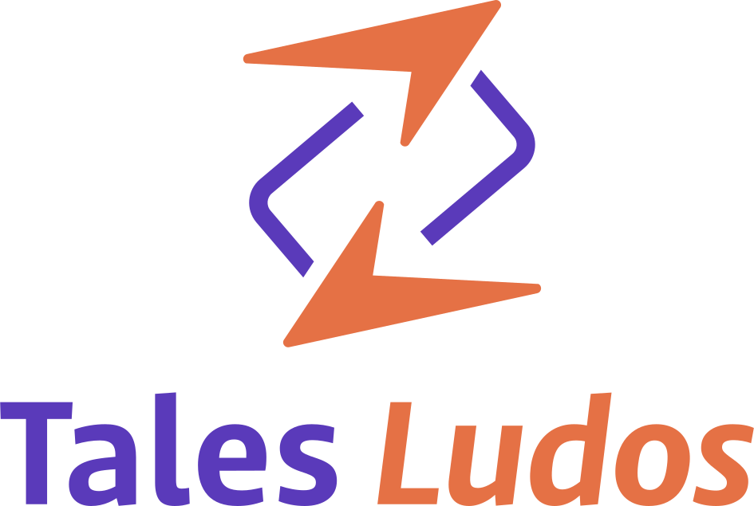
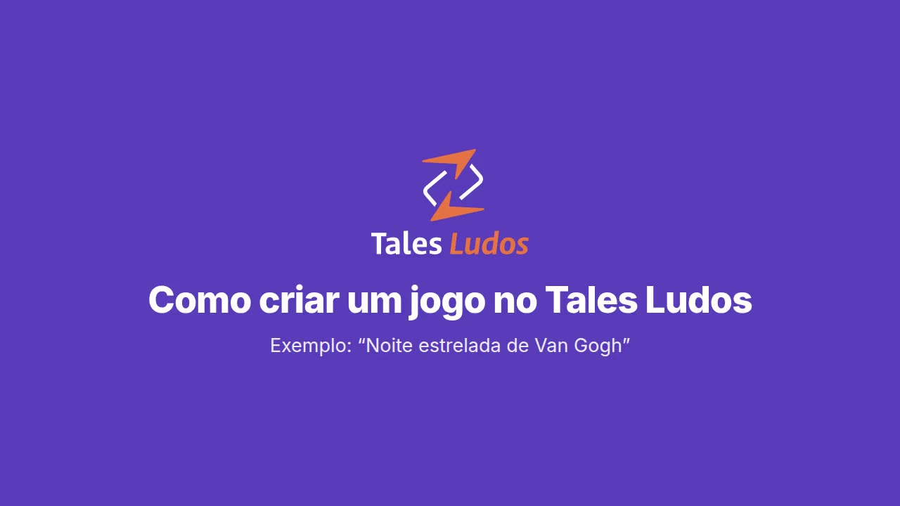

<p align="center">
  
</p>

# Tales Ludos (React)

Ferramenta de autoria de jogos educacionais baseados em um mapa: o autor escolhe uma imagem de fundo, marca locais
nela e define, para cada local, uma cena (conteúdo) e um desafio. No jogo gerado, os locais viram uma **trilha**
sobre a imagem: o jogador conclui um local por vez, com vidas, e a nota final pode ir para o Moodle (pacote SCORM 1.2).

Esta versão roda **inteiramente no navegador**, sem backend, banco de dados ou cadastro, no mesmo modelo do
eXeLearning online.

**Acesse:** https://luizedsilva.github.io/talesludos-react/

## Vídeo tutorial

[](https://luizedsilva.github.io/talesludos-react/video/como-criar-um-jogo.mp4)

*Clique na imagem para assistir (3min51s).* O vídeo mostra, do início ao fim, a construção do jogo
"Noite estrelada de Van Gogh":

1. **Dados do jogo**: título, apresentação com imagem inserida no texto, a pintura como imagem de fundo e a área de
   conhecimento;
2. **Mapa**: os quatro locais marcados sobre a pintura;
3. **Cenas e desafios** de múltipla escolha em cada local (do 2º ao 4º local, em velocidade acelerada);
4. **Jogando a trilha**: apresentação, cena, desafio e **Verificar**; o personagem caminha até o próximo local; um
   erro proposital mostra a perda de uma vida e as opções **Rever a cena** e **Tentar de novo**; no fim, a nota;
5. **Salvar projeto em arquivo** (`.tlud`) e **Exportar jogo (.zip)** para publicar ou enviar ao Moodle.

O vídeo não tem áudio: as explicações aparecem em legendas na tela. Ele também está na página inicial do site.

## Página inicial

A página inicial (`/`) apresenta a ferramenta, no estilo do site do eXeLearning, com a
[identidade visual](#identidade-visual) da marca e layout próprio, sem o cabeçalho do editor. O editor é aberto pelo botão **TalesLudos online**, que leva a **Meus jogos** (`/jogos`).

A página traz:

- **Destaque** em roxo, com a composição ilustrativa da marca e os botões **TalesLudos online** e **Exemplo de jogo**;
- **Não é preciso criar conta**: explica que os jogos são salvos localmente, no navegador, sem envio a servidor, e
  recomenda salvar o `.tlud` como cópia de segurança;
- **Como funciona** (cenário → locais → cenas e desafios → exportação), com os ícones da marca;
- o [vídeo tutorial](#vídeo-tutorial) com a construção do jogo "Noite estrelada de Van Gogh";
- **Por que usar**, **Sobre** (o projeto e seus valores: colaboração, acolhimento, disseminação e acessibilidade) e o
  **Histórico** das versões;
- **Apoio** (CAPES, UNIFAL-MG) e **Desenvolvido com** (React, p5.js).

## Identidade visual

O layout segue o *Manual de uso da marca* Tales Ludos.

| Cor | Hex | Uso |
|---|---|---|
| Roxo (principal) | `#5A3ABA` | cabeçalho, destaque, títulos, botões principais, marcas no mapa |
| Laranja | `#E57145` | chamadas para ação (**TalesLudos online**, **Visualizar**), marca selecionada no mapa |
| Cinza | `#E3E3E3` | fundos de seção e botões secundários, no lugar do branco |

- **Tipografia:** Inter (Google Fonts) em todo o site. A Jali Latin aparece apenas na assinatura (logo).
- **Assinatura (logo):** versão preferencial sobre fundo claro; versão *fundo colorido* (branco e laranja) no
  cabeçalho roxo do editor; versão em negativo (branca) no rodapé.
- **Elementos ilustrativos:** ícones em círculo (diálogo, controles, mapa, personagem, digital, temática) e
  composições de "circuito" em roxo, laranja e cinza.
- **Contraste:** nos botões laranja o texto é roxo-escuro (`#2C1D63`), pois branco sobre laranja não atinge o
  contraste mínimo para textos pequenos.

As cores ficam em variáveis CSS (`--tl-roxo`, `--tl-laranja`, `--tl-cinza`…) no início de
[src/styles.css](src/styles.css), que também ajusta as variáveis do Bootstrap (`--bs-primary` etc.). Os arquivos da
marca ficam em [public/images/marca/](public/images/marca/):

```
logo.svg                       assinatura preferencial (roxo e laranja)
logo-fundo-colorido.svg        sobre fundo roxo (branco e laranja)
logo-negativo.svg              sobre fundo roxo (toda branca)
simbolo.svg                    versão reduzida (só o símbolo), base do favicon
simbolo-fundo-colorido.svg     versão reduzida sobre fundo roxo
icone-<elemento>-<cor>.webp    ícones ilustrativos (roxo e laranja)
composicao-<cor>.webp          composições de fundo (roxo, laranja e cinza)
```

Os SVGs foram extraídos dos PDFs vetoriais do kit; ícones e composições foram reduzidos a partir dos PNGs do kit.
Ao criar novas peças, siga o manual: não aplique sombras, contornos ou cores fora da paleta na assinatura, não a
distorça e respeite a área de preservação ao redor dela.

## Como usar

- **Meus jogos**: os projetos ficam guardados no navegador (IndexedDB). O editor do mapa grava automaticamente.
- **Editor do mapa**: mostra os locais como a trilha do jogo, com o mesmo pontilhado e os rótulos "Início" e "Fim".
  Os nós ficam roxos quando o local está pronto, cinza com borda vermelha quando ainda falta o desafio e laranja
  quando estão selecionados.
- **Salvar projeto em arquivo**: baixa um `.tlud` (zip com `project.json` e a imagem de fundo). Use como cópia de
  segurança ou para continuar em outro computador, com **Abrir projeto**.
- **Visualizar**: abre o jogo em uma nova aba (`public/game/preview.html`, que lê o projeto do IndexedDB).
- **Exportar jogo (.zip)**: baixa o jogo pronto (`index.html`, motor do jogo, `config/game.js` e `imsmanifest.xml`).
  Descompacte e abra o `index.html`, publique em qualquer servidor estático ou envie ao Moodle como SCORM.

> Os projetos guardados no navegador são apagados se os dados do site forem limpos. Salve o `.tlud` regularmente.

## Desenvolvimento

Requer Node.js 18 ou superior (o deploy usa Node.js 22).

```bash
npm install
npm run dev      # servidor de desenvolvimento (http://localhost:5173)
npm run build    # gera dist/ (site estático)
npm run preview  # serve o dist/ localmente
```

O resultado de `npm run build` é um site estático. Como o app usa rotas do navegador (`/jogos/...`), o servidor deve
devolver `index.html` para caminhos desconhecidos.

### GitHub Pages

O workflow [.github/workflows/deploy.yml](.github/workflows/deploy.yml) publica o site a cada push na `main`
(ou manualmente em *Actions*). No repositório, em **Settings → Pages**, escolha **Source: GitHub Actions**.
O subcaminho (`/<repositório>/`) é definido por `BASE_PATH` no build, e o `404.html` (cópia do `index.html`)
faz as rotas `/jogos/...` funcionarem ao recarregar a página.

## Estrutura

```
public/game/          motor do jogo (trilha) copiado para cada jogo exportado; preview.html para visualizar
public/images/        imagens da interface
public/images/marca/  logos, ícones e composições da identidade visual
public/video/         vídeo tutorial da página inicial e sua capa
src/storage/          dados, sem dependência de React:
  db.js               IndexedDB (área de trabalho)
  project.js          modelo do projeto, áreas de conhecimento
  gameModel.js        regras do roteiro (marcas, cenas, desafios, validação)
  files.js            arquivo .tlud, pacote .zip do jogo, imsmanifest.xml
  actions.js          salvar arquivo, exportar, visualizar
src/components/       cabeçalho do editor, canvas do mapa (p5), editor de texto (Quill), editor de cena e desafio
src/pages/            telas: página inicial (Home.jsx), lista, dados do jogo, detalhes, editor do mapa
src/styles.css        tema da marca (variáveis --tl-*), estilos do editor e da página inicial (classes .landing-*)
```

### Motor do jogo (trilha)

O jogo exportado (e a visualização do editor) usa o motor em [public/game/](public/game/), em HTML, CSS e JavaScript
puros, sem dependências, com a identidade visual da marca:

- **Trilha sobre o mapa**: os locais ficam onde o autor os marcou na imagem e viram nós da trilha: concluído (✓),
  atual (laranja, pulsando, com o balão "Começar") e bloqueado (cadeado). O caminho já percorrido fica laranja e o
  personagem caminha até o próximo local a cada acerto.
- **Lição por local**: a cena e depois o desafio, em tela cheia, com barra de progresso, botão **Verificar** e uma
  faixa de resultado (roxa no acerto, laranja no erro). Locais sem cena vão direto ao desafio.
- **Vidas**: 3 corações. Cada erro custa uma vida; o jogador pode **Rever a cena** ou **Tentar de novo**. Sem vidas,
  ele relê a cena e recebe vidas novas. Em lacunas e associações, as respostas certas ficam travadas.
- **Nota**: `100 × (1 − erros / locais)`, no mínimo 0, como nas versões anteriores.
- **SCORM 1.2** ([js/scorm.js](public/game/js/scorm.js)): dentro do Moodle, o jogo envia `cmi.core.score.raw` (0 a
  100) e `lesson_status = completed` ao terminar, e guarda o progresso em `cmi.suspend_data` para o aluno continuar
  de onde parou. Fora de um LMS, nada é enviado.
- **Responsivo e acessível**: funciona no celular, com teclado (Enter verifica, Esc volta à trilha) e leitores de
  tela; respeita "reduzir movimento".

```
public/game/js/jogo.js       motor (trilha, lições, vidas, fim de jogo)
public/game/js/scorm.js      comunicação com o LMS (SCORM 1.2)
public/game/css/jogo.css     estilos com as cores da marca
public/game/font/            Inter (woff2) e sua licença OFL, para funcionar offline
public/game/media/           símbolo da marca e sprites do personagem
public/game/index.html       jogo de exemplo ("Descobrimento do Brasil")
public/game/preview.html     visualização do editor (lê o projeto do IndexedDB)
```

### Formato do jogo

O motor espera, em `config/game.js`, um objeto `game` com `title`, `introduce`,
`marks.coords` (frações 0..1 da área do mapa, que tem proporção 700×500), `links` sequenciais (marca k → k+1) e
`scenes`/`challenges` ligados à marca pelo `id`. Tipos de desafio: 1 verdadeiro ou falso, 2 múltipla escolha,
3 preenchimento de lacuna (palavras entre `$`), 4 associação, 5 resposta curta.

Os arquivos `.tlud` são compatíveis com os da versão Vue com armazenamento local, e o formato de `config/game.js` é o
mesmo das versões anteriores: jogos antigos rodam no motor novo (desafios sem `type` são tratados como verdadeiro ou
falso).
